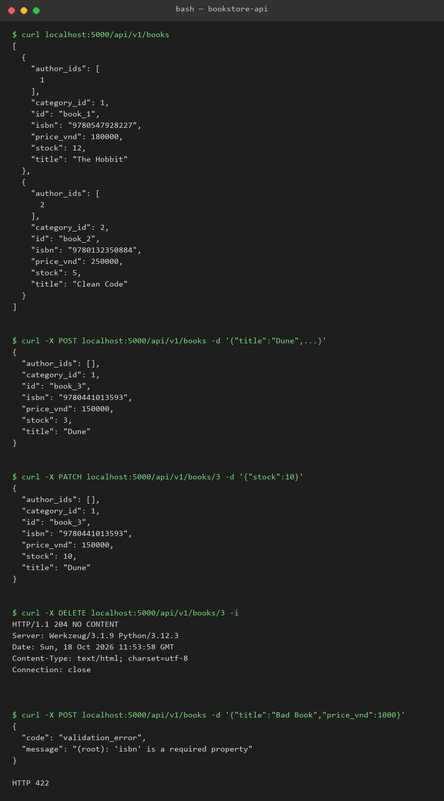

# Lec 5 - Lab 1: Bookstore API (Flask + SQLAlchemy)

## Nội dung

Thư mục [`bookstore-api/`](bookstore-api/) chứa REST API quản lý hiệu sách, hoàn thiện khung sườn trong slide bài giảng (models.py, routes/, schemas/):

```
bookstore-api/
  app.py              # khởi tạo Flask app, đăng ký blueprint, seed dữ liệu mẫu
  models.py            # 5 entity + quan hệ ORM (Flask-SQLAlchemy)
  routes/
    books.py            # CRUD /api/v1/books
    authors.py           # CRUD /api/v1/authors
    categories.py         # CRUD /api/v1/categories
    users.py              # CRUD /api/v1/users
    reviews.py             # CRUD (không có PATCH) /api/v1/reviews
    common.py               # helper validate JSON Schema + response lỗi
  schemas/
    book.json / book_patch.json / author.json / category.json / user.json / review.json
  requirements.txt
```

## 5 entity & quan hệ (theo slide)

| Entity   | Fields chính                     | Quan hệ                       |
|----------|-----------------------------------|--------------------------------|
| Book     | title, isbn, price_vnd, stock      | N:1 Category; N:M Author       |
| Author   | name, bio                          | N:M Book                       |
| Category | name, slug                         | 1:N Book                       |
| Review   | rating, book_id, user_id           | N:1 Book; N:1 User              |
| User     | email, display_name                 | 1:N Review                     |

- Quan hệ N:M giữa `Book` và `Author` dùng bảng trung gian `book_author`.
- `Book.to_dict()` trả `id` dạng `"book_{id}"` theo đúng ví dụ trong slide (`curl localhost:5000/api/v1/books`).

## Cài đặt & chạy

```bash
cd Lec5/bookstore-api
python -m venv venv
source venv/Scripts/activate      # Windows Git Bash; dùng venv\Scripts\activate trên cmd
pip install -r requirements.txt
python app.py
```

Server chạy tại `http://localhost:5000`. Lần chạy đầu tiên sẽ tự tạo `bookstore.db` (SQLite) và seed sẵn 2 category, 2 author, 2 book, 1 user để test nhanh.

## Test nhanh bằng curl

```bash
# Danh sách sách
curl localhost:5000/api/v1/books

# Tạo sách mới
curl -X POST localhost:5000/api/v1/books \
  -H "Content-Type: application/json" \
  -d '{"title":"Dune","isbn":"9780441013593","price_vnd":150000,"stock":3,"category_id":1,"author_ids":[]}'

# Lấy 1 sách
curl localhost:5000/api/v1/books/1

# Cập nhật một phần
curl -X PATCH localhost:5000/api/v1/books/1 -H "Content-Type: application/json" -d '{"stock":10}'

# Xoá
curl -X DELETE localhost:5000/api/v1/books/1 -i
```

Các entity còn lại (`authors`, `categories`, `users`, `reviews`) triển khai CRUD tương tự dưới cùng tiền tố `/api/v1/...`.

### Kết quả test thực tế



## Validate request

Mỗi route POST/PATCH validate body theo JSON Schema tương ứng trong `schemas/` bằng `jsonschema` (Draft7Validator + FormatChecker cho `email`). Lỗi trả về thống nhất dạng:

```json
{ "code": "validation_error", "message": "<field>: <mô tả lỗi>" }
```

Ngoài ra API còn trả:
- `404 not_found` khi id không tồn tại.
- `409 conflict` khi vi phạm unique (isbn, slug, email).
- `201 Created` khi tạo mới thành công, `204 No Content` khi xoá thành công.

## Quyết định thiết kế đáng chú ý

### 1. Bookstore dùng ORM thay vì dict in-memory như Lec4

Lec4 lưu task trong dict để tối giản khi tập trung vào OpenAPI spec. Lab1 yêu cầu rõ 5 entity có quan hệ N:1/N:M, nên dùng Flask-SQLAlchemy với SQLite để quan hệ (`relationship`, bảng trung gian `book_author`) được định nghĩa tường minh và dễ mở rộng, thay vì tự quản lý khoá ngoại bằng tay.

### 2. Validate bằng JSON Schema thay vì viết hàm kiểm tra thủ công

Thay vì lặp lại logic `if "field" in data and not isinstance(...)` như Lec4, mỗi entity có một file JSON Schema riêng trong `schemas/`, được nạp và validate qua `jsonschema.Draft7Validator`. Cách này tách rời "luật dữ liệu" khỏi code route, dễ đối chiếu với OpenAPI spec nếu viết thêm sau này, và `additionalProperties: false` giúp chặn field lạ mà không cần liệt kê thủ công trong route.
